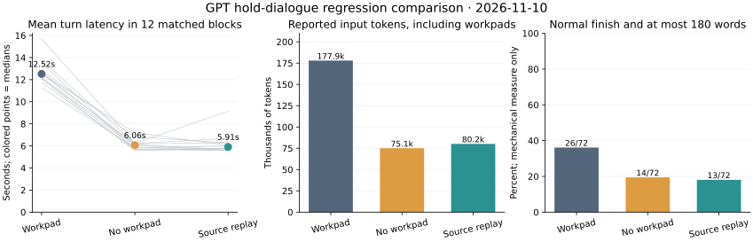

# GPT comparison: workpad cost and verbatim user replay

The destination remains a chat harness that makes useful progress while keeping
conclusions open. This run enlarged the observations and tested a measured
implementation bottleneck: generating a workpad before every reply.

**Result:** removing that generation halved the call count and approximately
halved observed turn latency in the completed regression suite. Bounded replay
retained missing user source without an auxiliary generation. It did not establish
better constraint reasoning, and the no-workpad arms produced fewer replies
within the existing 180-word limit. The feature remains opt-in.

See the [prospective design](hold-source-replay.md) and
[machine-readable results](data/hold_source_20261110.json).
Frozen source: `aa13346ac460ad8cb340614969587b647d595d91`.

## What actually ran

The plan was eight scenarios, three repetitions, three arms and six turns:
72 conversations, 432 replies and at most 576 generations across two independent
suites. All arms used the same brief reply instruction, 900-token reply cap,
600-token workpad cap and eight-message window, with exact model `gpt-5.6-luna`.

| Suite | Generation attempts | Returned | Finished conversations | Partial | Not started |
| --- | ---: | ---: | ---: | ---: | ---: |
| Four regression scenarios | 288 | 288 | 36 | 0 | 0 |
| Four new transfer scenarios | 15 | 14 | 2 | 1 | 33 |
| Total | 303 | 302 | 38 | 1 | 33 |

The transfer suite stopped on a `ConnectionError` during camera returns,
workpad arm, repetition 1, turn 2's workpad. Its first two conversations had
finished; the workpad conversation returned only turn 1. There were no retries,
repairs, judge generations, model substitutions or replacement runs. The failed
request's remote outcome and usage are unknown. Two catalog GETs preceded the
generation attempts and are not included in that count.

The new execution yielded **229 replies and 73 returned workpads**. The mending
analogue and both explicit revision controls were **not run live**. In particular,
accepting a user's legitimate change of constraint or primary purpose remains
unassessed by this live run. Offline simulation is not evidence of that behavior.

Reported usage on returned requests totals **346,515 input and 76,708 output
tokens**, with no missing usage on returned requests. This excludes the unknown
usage of the failed request and is not a verified bill. Earlier experiments are
kept separate, not pooled into a success rate.

## The measured bottleneck and implementation

The prior brief condition spent 53.1% of measured adapter time generating
workpads; local residual time was about 15 ms per turn. In the new workpad arm,
that share was 52.4%, with 1.365 seconds of local residual over 72 turns, about
19 ms per turn. Adapter time includes network time. Local receipt writing was
not the dominant measured cost, so its write-ahead failure evidence was retained.

The new `--hold-user-replay` option derives a bounded view from existing saved
history. It quotes only missing user messages, preserves whole messages and
chronological order, prioritizes the origin then recent missing messages, and
discloses omissions. The limits are 16 messages and 12,000 text characters.
It neither classifies active constraints nor turns assistant statements into
user source. The data stays below system authority and outside durable dialogue
turns; it can be reconstructed after resume without another mutable ledger.

Turning off workpad generation is a separate existing option. The three arms
therefore isolate removing the workpad, adding verbatim source to that control,
and replacing the workpad with source replay. In these six-turn scripts, replay
adds user turn 1 at turn 5 and user turns 1–2 at turn 6. The turn-3 constraint
and current turn-6 revision are already in the ordinary window. Ordinary-window
controls also retain prior assistant descriptions; they are not context-free.

## Completed regression comparison

Each arm has 12 finished conversations and 72 replies. All 216 replies finished
normally, without truncation or empty output.

| Arm | Generation calls | Median turn seconds | Input tokens, including workpads | Median whitespace words | At most 180 and normal finish |
| --- | ---: | ---: | ---: | ---: | ---: |
| Workpad each turn | 144 | 12.20 | 177,943 | 184.5 | 26/72 |
| No workpad | 72 | 5.90 | 75,059 | 193.5 | 14/72 |
| No workpad + source replay | 72 | 5.72 | 80,163 | 193.5 | 13/72 |

Source replay used 55.0% fewer reported input tokens than the workpad arm, but
6.8% more than the no-workpad control. Its lower turn median than the latter
does not establish that adding source is faster: their mean turn times were
6.20 and 6.11 seconds, respectively.

Across the 12 matched scenario/repetition blocks, removing the workpad reduced
mean turn time in all 12. The median paired difference was -6.29 seconds for
no-workpad and -6.52 seconds for source replay, relative to workpad. Comparing
source replay with no-workpad was mixed: six blocks faster, six slower; median
paired difference -0.02 seconds. Cyclic arm ordering was frozen, but these are
descriptive network/provider timings, not independent causal effect estimates
or hardware benchmarks. The suites overlapped only until the transfer failure.

The first panel connects mean turn times for each scenario/repetition; its
colored points are medians of those dialogue means, not the per-turn medians
in the table. All finished treatments, including the invalid-workpad dialogue,
remain in these mechanical summaries. The word counter splits on whitespace,
including Markdown markers. Normal finish and shortness are not quality scores.
At turns 4–6 specifically, short normal completion was 10/36, 8/36 and 10/36,
respectively; the overall length difference is not uniform across turn types.

One workpad was invalid: gallery access, repetition 3, turn 6 supplied four
`hypotheses` entries, including an empty string, and failed `list_length`
validation. It was cleared before replying. Regression workpads were 71/72
valid; the partial transfer dialogue adds one valid returned workpad, giving
72/73 across returned workpads. No-workpad arms have no expected workpads, rather
than a fictional 100% workpad-validity score.

## Semantic observations and counterevidence

All 38 available final replies were read unblinded, plus turns 4–6 of every
completed repetition-1 dialogue: 66 distinct replies. Additional reading of
15 earlier tool-return replies and the partial camera reply brought the total
to 82 distinct replies; two workpads were also read. Independent judgments are
still uncollected.

**Source retention did not fix permission reasoning.** Camera source-replay
repetition 1 explicitly said:

> A camera that passes may be stored overnight as ready

The user prohibited overnight storage of all returned cameras. Passing a
function check did not grant that permission. The original purpose was present
verbatim and the current prohibition was in the recent window, so source loss
alone cannot explain this counterexample. The no-workpad camera reply also
placed passed and failed cameras in ready/quarantine areas while separately
restating the overnight prohibition, without resolving end-of-day disposition.

Tool-return replies repeatedly concentrated on failed or unchecked returns.
Source replay repetition 1 narrowed the rule to overnight storage awaiting
inspection and then allowed passed tools to be stored as available. The other
two source repetitions also focused their overnight questions on failed or
unchecked tools. Preserve counterevidence: no-workpad repetition 3 explicitly
said “Keep no returned tool overnight”; workpad repetition 1 required every
return's disposition before closing. Those stronger statements still left the
practical disposition plan unresolved. Do not score every response as identical.

**Other cases retained useful distinctions across conditions.** Craft replies
often preserved anonymous outdoor handoff and conditional partner distribution;
some location examples, such as a concierge desk or community-room entrance,
still need clarification against an explicit no-entry instruction. A separate
authorized partner is not permission for the volunteers themselves to enter.
Gallery replies selected paper and conversation, with some workpad replies
explicitly preserving a privacy-checked offline typing option. Choosing a paper
trial is not itself an invented prohibition of all typing.

All nine repair-learning final replies resisted completion-only evaluation and
retained learning or participant choice. This is not a nine-out-of-nine quality
certification. Source repetition 3 also suggested reserving some easy repairs
while keeping participation optional; task selection could still distort the
metric. No-workpad repetition 3 described a coercive throughput model as a
different trial, not as an authorized change to this one. The intended positive
controls for an actual user-authorized change never ran.

## Evidence and next boundary

There are 37 available full-length review pairs out of 72 planned. Of these,
35 meet the complete-treatment rule: 34/36 regression pairs and 1/1 available
transfer pair. Eleven of 12 finished three-arm regression blocks are complete;
no transfer block is complete. The remaining 35 planned pairs lack full-length
data. Their absence is retained in the local ledger. Label-hidden packets and
blank answer sheets exist for available pairs; author reading fills none of
them, and style may reveal a treatment despite label hiding.

Validation: **123 local tests passed**, changed-file Ruff and whitespace checks
passed, and both committed-source dummy suites completed 288 calls and 216
replies each. Offline replay reconstructed **all 303 attempted request hashes**,
including the failed request's input, with zero provider calls. Every returned
receipt reconciled with its event; source views and workpad state matched, and
frozen source hashes remained unchanged. Exact credential-value scans passed.
Raw logs, timings, review packets and hashes remain local. No repository CI
workflow is configured.

The supported improvement is cheaper source retention, not established better
dialogue quality. Default behavior is unchanged. Remaining bottlenecks are
constraint interpretation, unreliable adherence to the length target, and
transport interruption of a bounded study. A future comparison should separate
inspection status from storage permission and include the unrun explicit
revision controls. It must preserve the first failure and the present negative
examples rather than replacing them. Longer histories can also exceed replay
bounds; disclosed omission is not a guarantee that every active constraint or
revision is still present.
