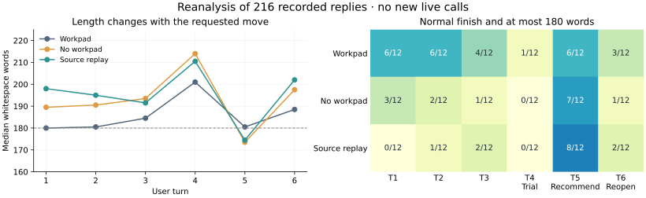

# Follow-up: where replies expand and constraints narrow

The goal remains useful conversation with conclusions held open. This follow-up
reanalyses the previous GPT recordings and adds explicit reply targets and
reusable offline diagnostics to the harness. **No new live provider calls were
made.** The new instruction has not yet demonstrated better model behavior.

The evidence is the [source-replay study](2026-11-10-source-replay-gpt.md): 303
generation attempts, 302 returned generations and 229 replies. The balanced
regression comparison contains 216 replies; 13 transfer replies remain a separate,
interrupted stratum. The original 33 unstarted conversations, unknown failed
request and unrun live revision controls remain unfilled.

Analysis implementation: `a916015442667c268893b334fadf93797ba3abd8`.
Original generation source: `aa13346ac460ad8cb340614969587b647d595d91`.
The [aggregate and quoted trace evidence](data/hold_followup_20261111.json)
retain the receipt/log hashes and analysis-entrypoint hash.

## Reply length depends strongly on the requested move

All these replies finished normally. Counts below use the unchanged
`whitespace_v1` definition, including standalone Markdown markers.

| User turn | Workpad: at most 180 words | No workpad | Source replay | Total |
| --- | ---: | ---: | ---: | ---: |
| 1: initial exploration | 6/12 | 3/12 | 0/12 | 9/36 |
| 2: resources and questions | 6/12 | 2/12 | 1/12 | 9/36 |
| 3: firm constraint | 4/12 | 1/12 | 2/12 | 7/36 |
| 4: develop a small trial | 1/12 | 0/12 | 0/12 | 1/36 |
| 5: provisional recommendation | 6/12 | 7/12 | 8/12 | 21/36 |
| 6: reopen or challenge | 3/12 | 1/12 | 2/12 | 6/36 |

Turn 4 has median lengths of 201, 214 and 210.5 words; turn 5 has 180.5,
173.5 and 174.5. Thirty of 36 turn-4 replies use Markdown headings, compared
with none at turn 5. Designing a trial and listing uncertainties often expands
into a multi-part response, whereas the recommendation request tends to compress
it. This is an observed association between tasks and response shape, not proof
that headings cause verbosity or that removing them improves quality.

Each cell/median uses 12 deliberately selected scenario/repetition observations.
The same conversations contribute multiple turns; these are not independent
population estimates. Source replay is inactive at turns 1–4 and active at 5–6.

## Differences exist before source replay is active

For every one of the 12 regression scenario/repetition pairs, the no-workpad and
source-replay **turn-1 system hash, message hash, temperature and output cap were
identical**. The resulting replies differed in all 12 pairs. Their median lengths
were already 189.5 versus 198 words, before any historical source was inserted.

Later differences also include the different replies accumulated in each history.
The current data therefore cannot attribute every no-workpad/source-replay
difference to the replay mechanism. In particular, the original overall rates
14/72 and 13/72 are not evidence that source replay itself makes replies longer.
The larger difference from workpad also varies by turn: at turn 5 both no-workpad
arms have more short replies than workpad. Preserve the per-turn view alongside
the overall 26/72, 14/72 and 13/72 results.

## The word counter is part of the measurement contract

The existing generic `avg_reply_words` metric uses regex `\w+`; the experiments
used `len(text.split())`. Applying the same 180 threshold to the two definitions
changes classification for **18 of 216 replies**. Whitespace counting gives
53 within the limit; regex counting gives 43. Fourteen pass only the whitespace
criterion and four only the regex criterion.

The original experiment's definition and results are retained. The harness now
names the shared counter `whitespace_v1`, and the generic analyzer adds
`avg_reply_whitespace_words` without silently reinterpreting `avg_reply_words`.
These are counts of text units, not semantic quality or language-independent
word segmentation.

## Scope narrowing can already be inside a valid workpad

The three final tool-return workpads were read alongside their replies. Their
focus fields mention the broad overnight restriction, but the details differ.

In repetition 2, a schema-valid workpad hypothesis says:

> tools not cleared cannot remain in the cabinet overnight.

The reply then says:

> Passing tools may be stored and relisted.

The user prohibited overnight storage of returned tools, including passing
returns. Narrowing is visible in the generated state before the visible reply;
a correct-looking focus field and successful schema validation do not establish
constraint fidelity. This trace does not isolate a causal effect of the workpad.

Repetition 3's next step similarly targets tools that cannot be approved
immediately; its reply narrows the prohibition to storage awaiting inspection.
Preserve the counterexample in repetition 1: the workpad covers all returns and
the reply requires disposition before closing. Its actual disposition plan still
needs confirmation. In the no-workpad source-replay camera case, the reply
explicitly allows a passed camera to remain overnight even though the current
user message forbids it. Both generated state and reply reasoning need scrutiny;
keeping more source text alone did not solve this permission inference.

The trace excerpts are authored, unblinded readings with exact source matches,
not automatic semantic labels or independent quality ratings. The live controls
where the user explicitly permits checked storage or changes the primary goal
are still unrun. A future constraint intervention must also accept those valid
revisions rather than permanently freezing the original rule.

## Harness changes and validation

`--hold-reply-max-words N` makes the reply target a saved, validated hold setting.
It adds a compact-response instruction and a `reply_contract` diagnostic with
the actual count, counter version, limit, status and excess. The full reply is
preserved when it exceeds the target; no automatic rewriting call or truncation
is added. This protects trailing qualifications from a mechanical cut, while
making noncompliance observable. Zero preserves the previous prompt behavior.
The diagnostic is not returned to the model or included in blind transcripts.

The separate `analyze_hold_run.py` command reads both completed and interrupted
source-replay runs. It checks frozen source copies, call/event reconciliation,
expected call order and timings before writing a new report outside the evidence
directory. Empty reserved files remain unstarted dialogues. Failed or started
requests retain unknown outcomes and usage; missing usage is not a successful
zero-cost generation. Analysis limits are labelled as analysis criteria, not
inferred model settings.

The new command reproduced all **303 attempts, 302 returns, 229 replies, 38
finished conversations, one partial and 33 unstarted**. It retained 72 planned
pair identities, 37 available pairs and 35 complete-treatment pairs. Original
source-run file hashes remained unchanged. No semantic scores were generated.

**137 local tests passed**, including invalid configuration before artifacts or
provider construction, persistence, current-user revision ordering, full-text
preservation, no extra generation, unknown/empty outcomes, corrupted receipts,
source drift and output protection. Changed-file Ruff and whitespace checks
passed. Two end-to-end dummy runs exercised the explicit storage and purpose
revision scripts with source replay and the new target: 12 replies, no workpad
generation, verified source and diagnostics. Dummy output does not establish
semantic acceptance of either revision. Credential-value scans passed.

See [usage and limitations](../hold_reply_contract.md). The supported change is
a more explicit, inspectable harness and reproducible analysis. Whether the new
instruction improves concise useful answers requires a fresh bounded comparison.
Constraint reasoning remains an open behavioral problem; a future policy should
distinguish an item's inspection state from permission to perform an action,
while keeping explicit user revisions admissible.
